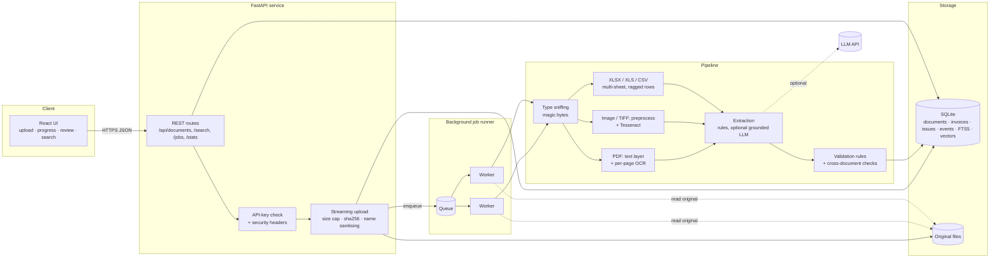
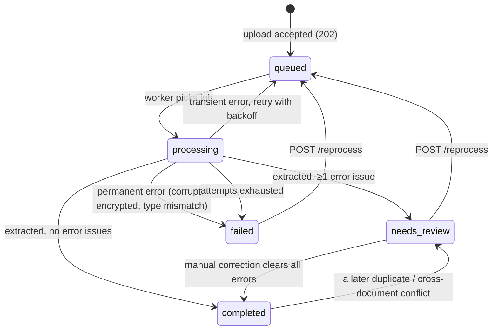
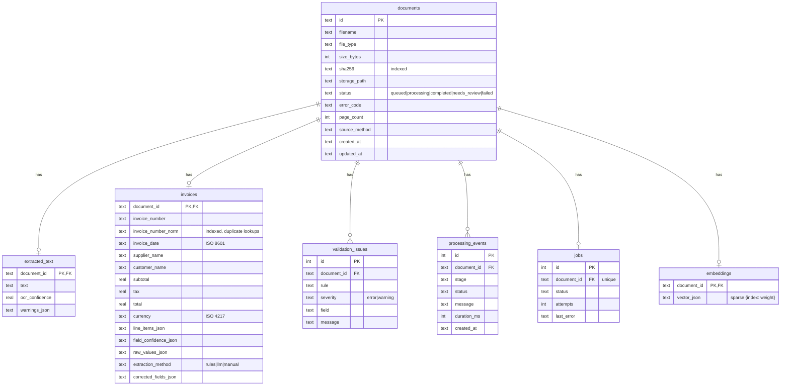

# Architecture and design decisions

## 1. System overview

## 2. Processing lifecycle

Every transition writes a row to `processing_events`, so the UI's "Processing history" is the audit trail.

## 3. Pipeline detail

| Input | Path | Notes |
|---|---|---|
| Digital PDF | pdfplumber text layer | Per page; pages with < 20 characters are treated as scans |
| Scanned PDF / mixed PDF | pypdfium2 render at 300 dpi → OCR for those pages only | Hybrid PDFs cost OCR only for the scanned pages |
| PNG / JPG / TIFF | grayscale → upscale to ≥1600 px → autocontrast → median denoise → Otsu threshold → Tesseract (`--psm 3`) | Multi-frame TIFF: each frame OCR'd in turn (up to 20) |
| XLSX / XLS | every sheet read raw (`header=None`), empty rows/columns removed | Produces both a cell grid (for line-item tables) and `Label: value` text |
| CSV | csv module with delimiter sniffing, encoding fallback (utf-8-sig → cp1252 → latin-1), rows padded | Key/value header block plus item table in one file |

Failure handling by class:

| Class | Examples | Behaviour |
|---|---|---|
| Permanent | corrupt bytes, truncated PDF, password-protected PDF, extension ≠ content, empty document | `failed` immediately with `error_code`; never retried |
| Transient | Tesseract not installed or crashed, unexpected exception | retried with exponential backoff (1 s, 2 s, …) up to `DI_MAX_ATTEMPTS`, then `failed` with `processing_failed` |
| Resource limits | file > 25 MB, > 50 files per request, > 200 OCR pages, > 20 sheets, > 20 000 rows per sheet | rejected or truncated with an explicit warning |

## 4. Extraction

Two extractors share one output contract (`ExtractionResult`: fields, line items, per-field confidence,
raw unparseable values, warnings).

**Rule-based (default, deterministic).**
* Labels are matched per line, with synonyms (`Invoice No`, `Inv. #`, `Bill No`, …; `Vendor`, `Seller`, `From`, …).
  A label may have its value on the same line or the next non-empty line (`Bill To:` blocks).
* Amounts: handles `1,234.50`, `1.234,50`, currency symbols and codes, and rate notes such as `VAT (15%)`.
* Dates: ISO, `dd/mm/yyyy`, `mm/dd/yyyy`, `15 Mar 2025`, `March 15, 2025`, `15-Mar-2025`. Ambiguous
  day/month pairs are read day-first and marked lower confidence with a warning.
* Currency: ISO code near the total first, then `Tk`/`BDT`, then symbols (`$` is low confidence because
  several currencies use it).
* Line items: from the table (header detection on spreadsheets) or from `desc qty unit amount` text lines.

**Optional LLM (`ANTHROPIC_API_KEY`).** The model returns JSON. Every value is then **grounded**: a value is
kept only if its literal form appears in the document text. Ungrounded values are discarded with a
`llm_value_discarded:<field>` warning and the rule-based value is kept. Any HTTP, timeout or JSON error
falls back to the rules with a warning. Prompt: see [AI_USAGE.md](AI_USAGE.md).

**Never invent.** Missing → `null`, confidence absent. Validation then reports `MISSING_*`.

## 5. Validation

Validation is a pure function of (record, line items, other documents, processing warnings). That makes
each rule unit-testable and keeps the database out of the rule logic. Cross-document rules need the other
records, so the orchestrator passes in same-invoice-number documents and same-hash files.

Cross-document decision table (same normalised invoice number, other document found):

| Supplier | Values | File types | Result |
|---|---|---|---|
| same | differ | any | `CROSS_DOCUMENT_MISMATCH` (error) |
| same | agree | same | `DUPLICATE_INVOICE` (error) |
| same | agree | different | `CROSS_DOCUMENT_MATCH` (warning, "verified") |
| different | any | any | `INVOICE_NUMBER_REUSED` (warning) |

When a document is processed or corrected, its siblings (same number or same file hash) are re-validated,
so a flag appears on both members of a pair whichever is processed first.

## 6. Concurrency

* Workers run OCR and extraction in parallel.
* The cross-document step (persist → validate → re-validate siblings) runs under one process-wide lock.
  Without it, two duplicates processed on parallel workers could each validate before the other is
  visible, and a stale `completed` could overwrite a `needs_review` flag. The evaluation caught this
  (see EVALUATION.md, "Defects found during evaluation").
* SQLite runs in WAL mode with a busy timeout, and each write is a short transaction.

## 7. Database schema

Tables (full DDL in `backend/app/db.py`):

`documents_fts` is an FTS5 virtual table (`porter unicode61` tokenizer) holding filename and body text
(extracted text plus the invoice identifiers) for keyword search.

Production mapping: the same schema translates to PostgreSQL with `jsonb` for the JSON columns, a
`tsvector` GIN index in place of FTS5, `pgvector` for embeddings, and `invoice_number_norm` as a btree index.

## 8. Search

| Mode | Mechanism | Strength | Weakness |
|---|---|---|---|
| keyword | FTS5 `MATCH` with quoted terms, BM25 ranking, `snippet()` highlights | exact identifiers (`INV-2025-0042`), names | no synonyms |
| semantic (vector) | stateless `HashingVectorizer` (1–2 grams, English stop-words, 2¹⁸ buckets), L2-normalised, cosine via sparse dot product | finds related documents with overlapping vocabulary; no re-fitting when documents arrive | not neural; no synonym or paraphrase understanding |
| hybrid | reciprocal-rank fusion, k = 60, over both rankings | robust default | — |

For production, the vector store would hold dense sentence embeddings (for example from the LLM provider or a
local model) in `pgvector`, with an approximate index such as HNSW. Only `search.py` changes.

## 9. Scalability and reliability

| Concern | Current | Scale-out path |
|---|---|---|
| Ingest throughput | Streaming upload, bounded worker pool | Separate API and worker processes; object storage for files |
| Queue | In-process threads plus DB-backed job rows; re-queue on restart | BullMQ/Redis or SQS with the same job contract; `submit()` and the worker loop change only |
| OCR cost | Digital text first; OCR only scanned pages; per-PDF page cap | Dedicated OCR worker pool, GPU OCR for large volume |
| Database | SQLite WAL | PostgreSQL; read replicas for search and listing |
| Duplicate checks | Indexed `invoice_number_norm` lookup | Same index in Postgres; unique constraint per (supplier, number) |
| Failure isolation | Permanent vs transient classes; worker loop never dies on an exception | Dead-letter queue for jobs exhausted after retries |
| Observability | `processing_events`, `/api/stats`, `/api/jobs` | OpenTelemetry traces and metrics |

## 10. Security

* Extension allow-list **and** content sniffing (magic bytes). A `.png` that is really text is rejected.
* Filenames are reduced to a basename and sanitised; stored files use UUID names, so client filenames never
  reach the filesystem path. Downloads are checked to stay inside the upload directory.
* Size limits enforced while streaming, not after buffering.
* Optional API-key authentication (`DI_API_KEY`); liveness endpoint stays open.
* Strict Pydantic validation on corrections: unknown fields are rejected (`extra="forbid"`), currency must be a
  three-letter code, lengths are bounded.
* Security headers: `nosniff`, `X-Frame-Options: DENY`, `Referrer-Policy: no-referrer`. CORS restricted to
  configured origins.
* SQL is parameterised throughout; LIKE filters escape wildcards.
* The UI renders all extracted text as React text nodes. Only the `<mark>` search highlight is interpreted.
* Not yet implemented: user accounts and per-user authorisation, rate limiting, encryption at rest, malware
  scanning of uploads. These are the next items for production.

## 11. Trade-offs

| Decision | Alternative considered | Why this choice |
|---|---|---|
| SQLite + FTS5 | PostgreSQL from day one | Runs with zero infrastructure while keeping the schema portable |
| In-process job runner | BullMQ/Redis | Same contract, no broker to run for evaluation; retry and recovery are still real |
| Rule-based extraction as default | LLM only | Deterministic, free, testable; the LLM is an upgrade that is grounded, not trusted |
| Stateless hashing vectors | Dense embeddings | No model download or API dependency; swap point is isolated in `search.py` |
| FastAPI | NestJS | Python-first OCR and data stack (Tesseract, pandas, pdfplumber) |
| React + Vite | Next.js | A single-page operator tool does not need SSR; smaller build |
